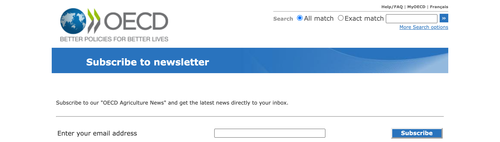
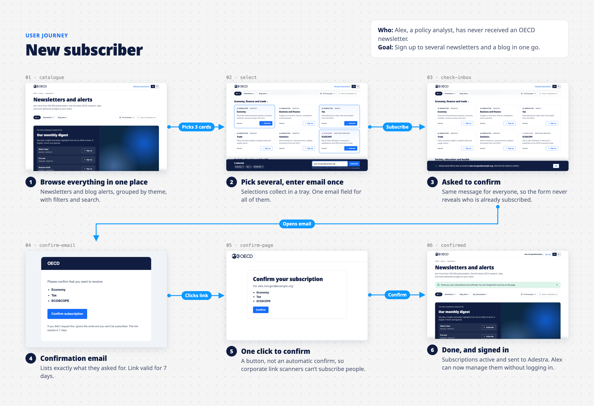
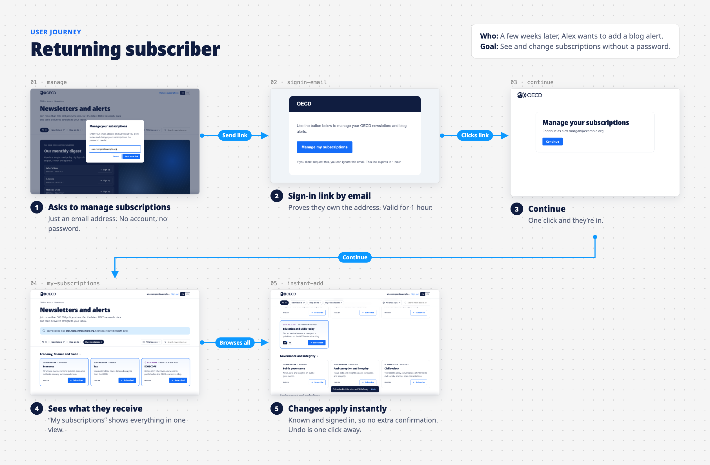
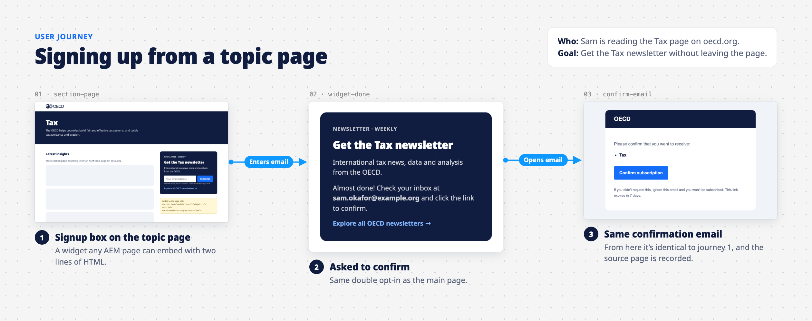
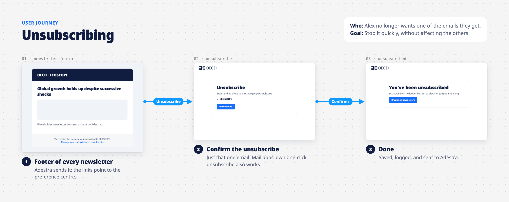
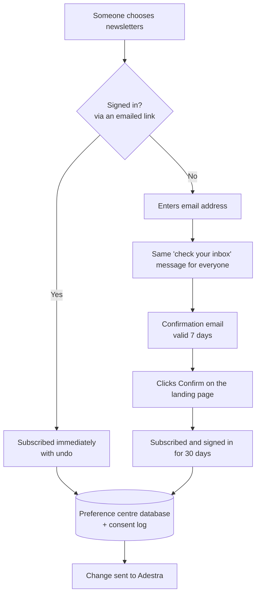
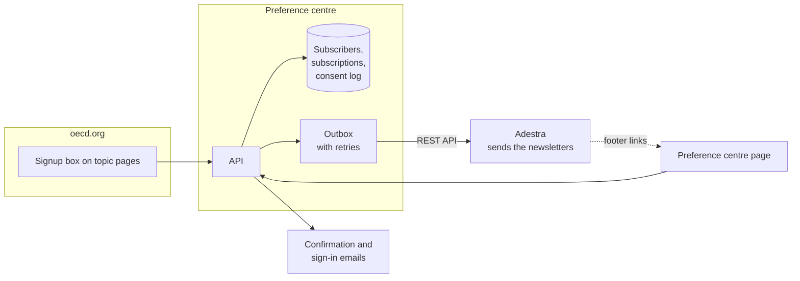

# OECD newsletter preference centre

One modern place where people can discover every OECD newsletter and blog alert, sign up to several at once, and manage what they receive, plus a small signup box that any oecd.org page can embed.

**Live prototype:** https://oecd-preference-centre.jakob-fix.workers.dev

---

## Why

### Today

oecd.org lists 27 newsletters. Each "Subscribe" button opens a separate, older-style page on account.oecd.org that signs you up to **one** newsletter at a time:



- **One newsletter per form.** Someone interested in Tax, Economy and Trade fills in the same form three times.
- **Three different systems.** Most newsletters use account.oecd.org, but *Noticias OCDE* and the Tokyo Centre newsletter use Adestra's own forms instead.
- **No way to see or change subscriptions.** There's nowhere a subscriber can see everything they receive.
- **Doesn't look like oecd.org.** The form uses the old OECD design.
- **Blog alerts have nowhere to go.** There's no place for them next to the newsletters.

### Proposed

The same pattern major news organisations use for their newsletters (the New York Times, the Guardian, the Atlantic, the BBC): a single catalogue with cards, multi-select, and a self-service preference centre.

| | Today | Proposed |
|---|---|---|
| Sign up to several newsletters | One form per newsletter | Pick any number, enter email once |
| Blog alerts | Nowhere | Alongside the newsletters, same flow |
| Languages | Separate links per language | One card per topic with EN / FR / ES… editions |
| See and change what I receive | Not possible | "My subscriptions", changes saved instantly |
| Sign up from a topic page | Link away to a separate form | Embedded signup box, two lines of HTML in AEM |
| Look and feel | Old OECD design | Current oecd.org fonts, colours and logo |
| Who owns subscriber data | Spread across account.oecd.org and Adestra | The preference centre, the single source of truth; Adestra only sends the emails |
| Proof of consent | Held in account.oecd.org (not reviewed here) | Every request, confirmation and unsubscribe logged with time and source |

---

## User journeys

Screens below are from the working prototype. Blue arrows show what the person does to move to the next step.

### 1. New subscriber



A first-time visitor picks three items (two newsletters and a blog alert), types their email once, and confirms from their inbox. Confirming also signs them in, so they can immediately see and adjust their subscriptions.

### 2. Returning subscriber



No account or password. They ask for a link by email, and once signed in, every change applies immediately with an undo option. Because they've proven they own the address, nothing needs re-confirming.

### 3. Signing up from a topic page



The same signup, embedded in any oecd.org page. Editors add it in AEM with two lines of HTML; it uses the page's own fonts and records which page the signup came from.

### 4. Unsubscribing



Every newsletter footer links back to the preference centre. Unsubscribing stops just that one email, and also works through mail apps' built-in unsubscribe buttons (Gmail, Apple Mail, Outlook).

---

## When do we ask people to confirm?

We confirm by email whenever we don't yet know that the person typing is the owner of the address. The page shows the same message whether or not an address is already subscribed, so the form can't be used to find out who is on our lists.



## How the pieces fit



- **The preference centre owns the subscriber list.** Adestra is told about every change but never decides who is subscribed, which also means it could be replaced later without touching this.
- **Confirmation and sign-in emails are sent by the preference centre**, not by Adestra.
- **If Adestra is unavailable, nothing is lost:** changes wait in the outbox and are retried every 5 minutes.

## What's needed to go live

- **Build on Azure.** The prototype runs on Cloudflare; the code is written so the move is mostly swapping a few adapters (see below).
- **Adestra setup.** One list per newsletter edition, a field for the "manage subscriptions" link, and a way to receive bounces and complaints. The Adestra connection exists but hasn't been tested against our account.
- **An email sending domain** for confirmation emails (e.g. `newsletters.oecd.org`).
- **Brand assets:** a PNG logo for emails, and sign-off on the design.
- **AEM:** allow the signup box's script on oecd.org pages (Content Security Policy).
- **Data protection review** of the consent wording, the consent log, and retention.
- **Bot protection** on the forms (e.g. Cloudflare Turnstile).

---

## For developers

### Run it locally

```bash
npm install
cp .dev.vars.example .dev.vars   # then set SIGNING_SECRET to a long random string
npm run db:migrate
npm run dev
```

Open http://localhost:8787. The yellow "Prototype" bar links to:

- **Mailbox** (`/dev/mailbox`): the confirmation and sign-in emails the prototype "sent". Click the links in them to continue the flow.
- **Adestra sync** (`/dev/adestra`): the outbox of changes pushed to Adestra, the consent log, and a sample newsletter footer with manage/unsubscribe links.
- **Widget demo** (`/demo/tax.html`): the signup widget on a mock oecd.org topic page.

### Deployed prototype

Cloudflare Workers + D1. The `/dev/*` pages need a password, user `oecd`; set it with `wrangler secret put DEV_PASSWORD`. Deploy changes with `npm run deploy`; apply new migrations with `wrangler d1 migrations apply prefs --remote`.

### Regenerating the journey images

With the dev server running:

```bash
npm run journeys
```

This resets the local database, walks through each journey in headless Chrome (`scripts/capture-journeys.mjs`), and lays the screenshots out as boards (`scripts/build-journey-boards.mjs`). Step titles and captions live in the second script.

### How it works

| Situation | What happens |
|---|---|
| Visitor picks newsletters and enters an email | Confirmation email with a signed link (valid 7 days). Response is the same whether or not the address is known. |
| They click the link | A page with a **Confirm** button (POST, so email link scanners can't confirm on their behalf). Subscriptions are saved, changes queued for Adestra, and they're signed in for 30 days. |
| Signed-in visitor | Toggles take effect immediately, with undo. "My subscriptions" filter. |
| "Manage subscriptions" | Email a one-hour sign-in link. No passwords. |
| Newsletter footer | "Manage" link (signs them in) and per-newsletter unsubscribe link (also supports RFC 8058 one-click). The manage URL is pushed to Adestra as a contact field. The manage link doesn't expire, so anyone a newsletter is forwarded to can use it. |

Changes go to an `outbox` table and are pushed to Adestra straight after the request, with a cron trigger every 5 minutes retrying failures. Every request, confirmation, subscribe and unsubscribe is recorded in `consent_events`.

### Catalogue

`src/catalogue.ts` lists topics (newsletters or blogs), each with one or more language **editions**. An edition is what people subscribe to and maps to one Adestra list. Newsletter names and descriptions come from oecd.org; the blogs and all Adestra list IDs are placeholders.

### Embedding the widget

```html
<script type="module" src="https://<preference-centre-host>/widget.js"></script>
<oecd-newsletter-signup topic="tax" lang="en"></oecd-newsletter-signup>
```

The embedding site's origin must be listed in `WIDGET_ORIGINS`, and its Content Security Policy must allow the script and API calls.

### Code layout

- `src/index.ts`: routes (API, email-link pages, dev tools)
- `src/store.ts`: database access and the Adestra outbox
- `src/adestra.ts`: fake adapter (default) and REST adapter (used when `ADESTRA_API_KEY` is set; **untested** against a live account)
- `src/tokens.ts`: HMAC-signed tokens for confirm, sign-in, session, manage and unsubscribe links
- `src/mail.ts`: transactional emails (stored in `dev_mail` for now)
- `public/`: catalogue page (`index.html`, `app.js`, `styles.css`), widget, demo page
- `scripts/`: journey screenshot and board generation

### Not done yet

- Real email sending (Cloudflare Email Service now, Azure Communication Services later)
- Bot protection on the signup and sign-in endpoints (Turnstile) and rate limiting
- Receiving bounces and complaints back from Adestra
- Verifying the Adestra REST adapter against a real account
- Analytics, accessibility audit, full French copy for the server-rendered pages

### Moving to Azure

The code is written to keep the move small: Hono runs on Azure Functions or App Service, the SQL is plain enough for Azure SQL or Postgres, the outbox can become a Storage Queue, and email/Adestra are behind small interfaces.
